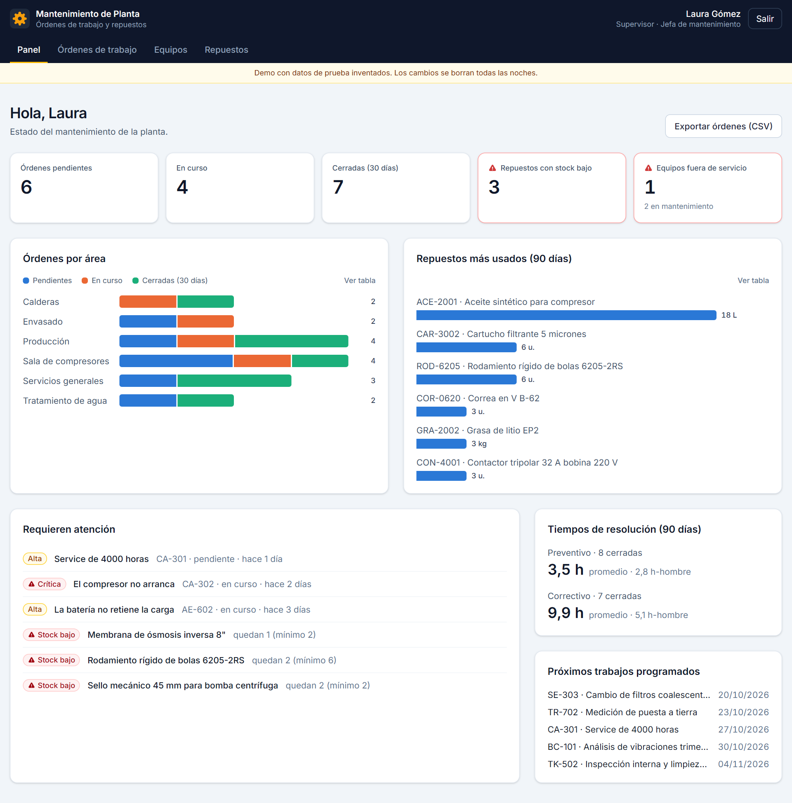
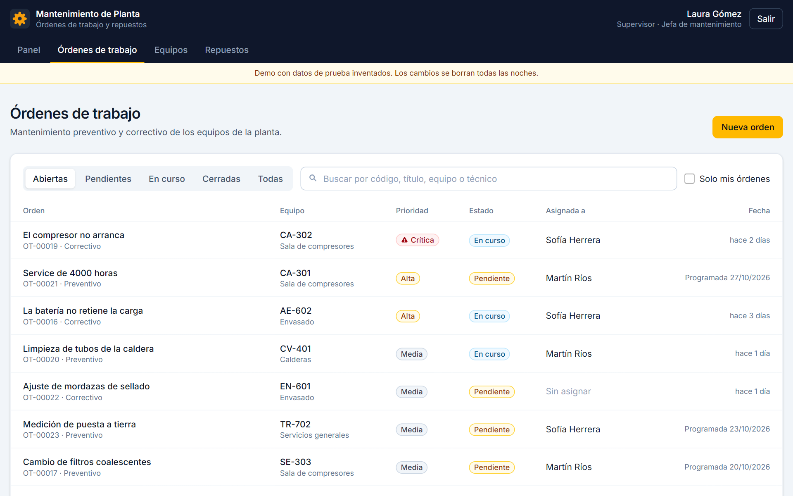
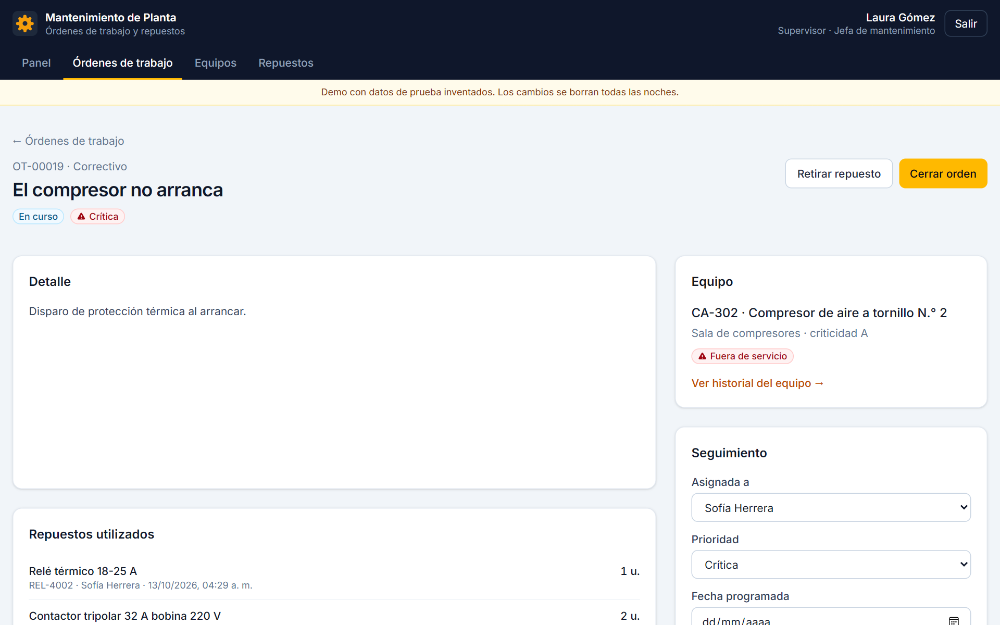
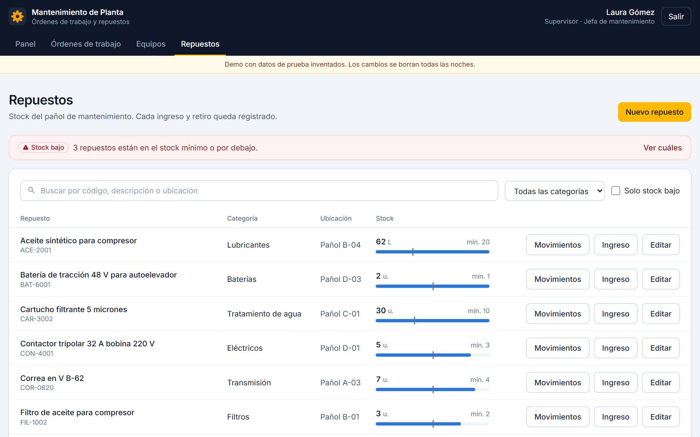
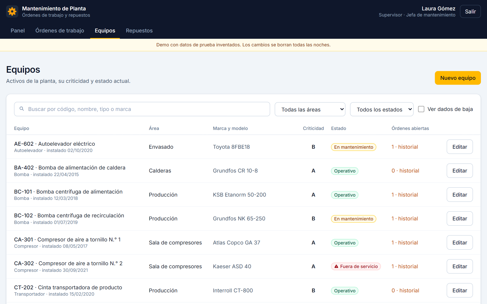
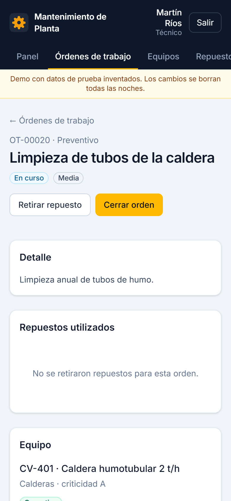

# Mantenimiento de Planta

Sistema web para el área de mantenimiento de una planta industrial. Permite gestionar los equipos de la planta, las órdenes de trabajo preventivas y correctivas y el stock del pañol de repuestos, con reportes para la jefatura. Lo hice como proyecto personal para practicar el desarrollo de herramientas internas para la industria.

**Demo en línea:** [alesandrovi.github.io/mantenimiento-planta](https://alesandrovi.github.io/mantenimiento-planta/). Se puede entrar con un clic como supervisor o como técnico. Los datos son inventados y se reinician todas las noches.



## Funcionalidades

- **Equipos:** listado de los activos de la planta con área, marca y modelo, criticidad (A, B o C) y estado (operativo, en mantenimiento o fuera de servicio). Cada equipo tiene su historial de órdenes y se puede dar de baja sin perder ese historial.
- **Órdenes de trabajo:** ciclo pendiente → en curso → cerrada, con prioridad, técnico asignado y fecha programada. Al cerrar una orden se registran las horas trabajadas y las notas de cierre. Las fechas de inicio y cierre las pone la base de datos, no el navegador.
- **Repuestos:** stock del pañol con ubicación y stock mínimo, y alerta cuando un repuesto queda en el mínimo o por debajo. El stock solo cambia con ingresos o retiros, así cada movimiento queda registrado con fecha, usuario y orden de trabajo.
- **Panel y reportes:** órdenes abiertas y cerradas, órdenes por área, repuestos más usados, tiempo promedio de resolución por tipo de orden y próximos trabajos programados. Las órdenes se pueden exportar a CSV para abrirlas en Excel.
- **Dos roles con permisos distintos:**
  - **Supervisor:** da de alta equipos y repuestos, crea y asigna órdenes, carga ingresos de stock y puede reabrir órdenes cerradas.
  - **Técnico:** reporta fallas, toma órdenes libres, inicia y cierra las suyas y retira repuestos para las órdenes que tiene en curso.

## Seguridad

Los permisos no dependen de lo que muestra la interfaz: los controla la base de datos con **Row Level Security (RLS)** de PostgreSQL.

- Sin iniciar sesión no se puede leer nada.
- Las políticas definen qué filas puede leer y modificar cada rol.
- Hay reglas de negocio en triggers. Por ejemplo, una orden no se cierra sin notas, no se retira más stock del que hay y un técnico no puede reasignar órdenes.
- Nadie puede borrar registros desde la API.

El archivo [`supabase/tests/rls.sql`](supabase/tests/rls.sql) tiene 29 pruebas automáticas. Cada una se hace pasar por un usuario de demo y verifica qué puede y qué no puede hacer. Las pruebas corren dentro de una transacción que se descarta al final, así que no modifican los datos.

## Tecnologías

- React 19 + Vite
- Tailwind CSS 4
- Supabase: PostgreSQL, autenticación, RLS y pg_cron para reiniciar los datos de la demo
- React Router
- GitHub Actions + GitHub Pages para la publicación

## Capturas

| Órdenes de trabajo | Detalle de una orden |
|---|---|
|  |  |

| Stock de repuestos | Equipos | Celular (técnico) |
|---|---|---|
|  |  |  |

Las capturas usan los datos de prueba de la demo.

## Cómo ejecutarlo

Se necesita [Node.js](https://nodejs.org/) 20 o superior y un proyecto de [Supabase](https://supabase.com/), que puede ser el plan gratuito.

1. Instalar las dependencias:
   ```bash
   npm install
   ```
2. Crear la base de datos. En el **SQL Editor** de Supabase, ejecutar en este orden los archivos de `supabase/migrations/` y después `supabase/seed.sql`, que crea los usuarios de demo y carga los datos de prueba. Con la [CLI de Supabase](https://supabase.com/docs/guides/local-development/cli/getting-started) se puede hacer lo mismo con `supabase link` y `supabase db push`.
3. Copiar `.env.example` como `.env.local` y completar la URL y la clave publicable del proyecto (Project Settings → API Keys).
4. Iniciar el servidor de desarrollo:
   ```bash
   npm run dev
   ```
5. Abrir `http://localhost:5173` y entrar con los botones de demo.

Para correr las pruebas de seguridad, pegar `supabase/tests/rls.sql` en el SQL Editor y ejecutarlo. El resultado aparece en el mensaje final.

## Estructura

```
├── src/
│   ├── paginas/              # Panel, órdenes, detalle de orden, equipos, repuestos y login
│   ├── componentes/          # Layout, componentes de interfaz, insignias y gráficos
│   └── lib/                  # Cliente de Supabase, sesión, consultas y formatos
├── supabase/
│   ├── migrations/           # Esquema, RLS, triggers, vistas de reportes y datos de demo
│   ├── seed.sql              # Usuarios de demo y carga inicial
│   └── tests/rls.sql         # Pruebas de permisos y reglas de negocio
├── capturas/                 # Imágenes del README
└── .github/workflows/        # Publicación automática en GitHub Pages
```

## Autor

Miguel Alesandro Villalba · [Portfolio](https://alesandrovi.github.io/portafolio/) · [LinkedIn](https://www.linkedin.com/in/alesandro-villalba-bb6508367)
